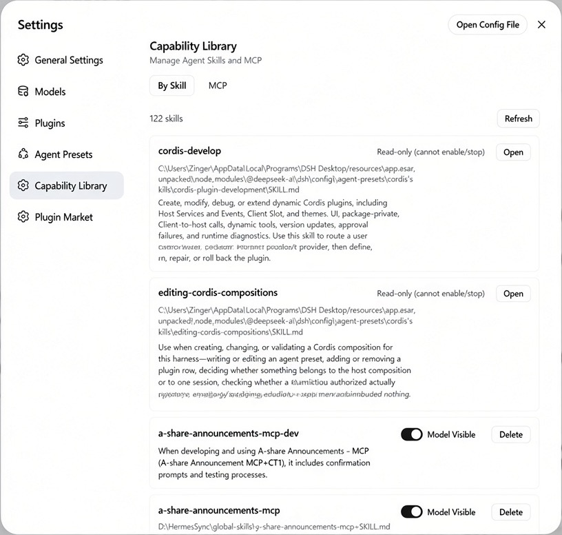
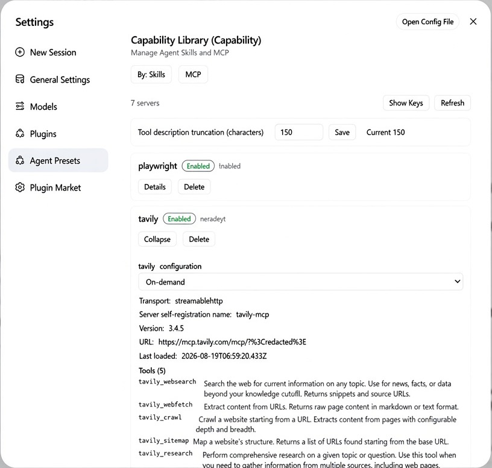

# skill-mcp-manager

Skills and MCP servers for an [ACRYL Blends](https://acrylblends.github.io) app, managed from **Settings > Skills & MCP**:

- **Skills**: every skill the agent can use (a folder with a `SKILL.md`), whether the model sees it, open it in your editor, delete it.
- **MCP servers**: the servers the agent knows, each one always loaded, loaded on demand or off, and per tool on or off. Read a server's
  description, refresh its tool list, show or hide its secrets, delete it.
- **For the agent**: `mcp_register` adds a server, `mcp_load` connects one only when it is needed, `mcp_call` calls its tools. A server
  that is not loaded costs no context.

| Skills | MCP servers |
|---|---|
|  |  |

Shown in DeepSeek Harness, where alone-tree made it, with the labels in English; in a Blends app the section is called Skills & MCP.

## Add it

Every Blends app made or upgraded with acrylblends 1.5.19 or later has it already: the frame installs it from npm (`skill-mcp-manager`).
Bring an older app up with `npx acrylblends@latest upgrade`, then `npm install`.

Pulling it as a plugin (`npm run acryl -- plugin pull github:cordisplugins/skill-mcp-manager`) is only for an app you do not upgrade. It needs
acrylblends 1.5.17 or later for its Settings section to show. In an app that has it built in, a pulled copy is refused because its tools
are already registered; remove it with `npm run acryl -- plugin remove skill-mcp-manager`.

Everything it keeps (the server list, its settings) is in the app's own home, `~/.acryl/apps/<app>/data/skill-mcp-manager/`.

## Where it comes from

A port of [alone-tree/dsh-skill-mcp-manager](https://github.com/alone-tree/dsh-skill-mcp-manager) 1.2.2 (MIT, its history is kept
in this repository) from the DeepSeek Harness to ACRYL Blends apps. What changed:

- The package is `skill-mcp-manager`, and its screens and the text the model reads are in English.
- `lib/` is unchanged otherwise. `npm run build` bundles it with its npm dependencies (the MCP SDK, cross-spawn) into
  `dist/server.js`, because a pull installs nothing; `index.js` names the plugin and the services it needs so the pull can read them.
- The original READMEs are in [docs/upstream](docs/upstream).

## Develop

```sh
npm install
npm run build
for t in test/*-smoke.mjs test/smoke.mjs test/schema-check.mjs; do node "$t"; done
```

MIT, Copyright (c) 2026 alone-tree; see [LICENSE](LICENSE).
